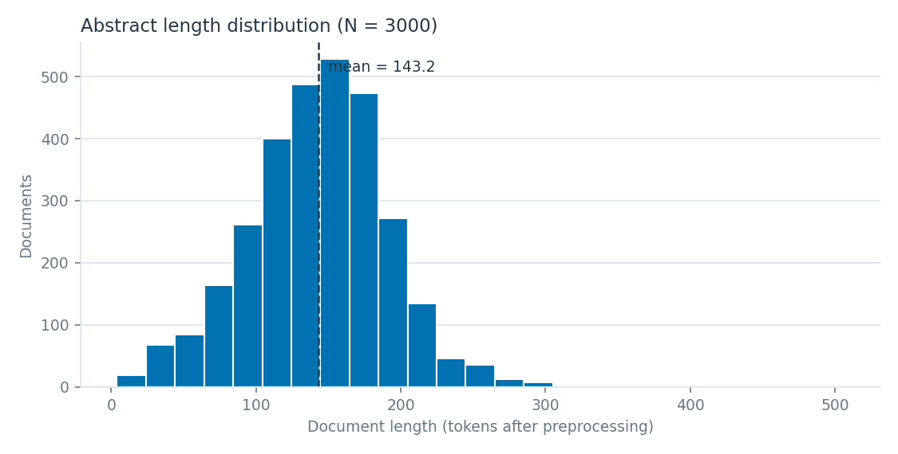
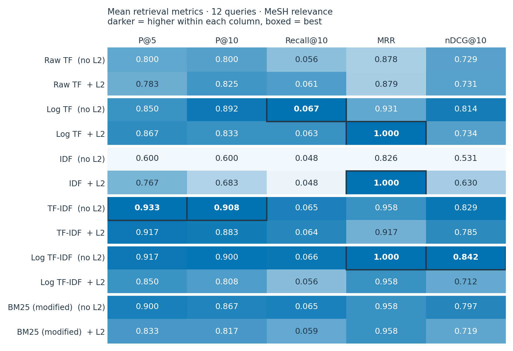
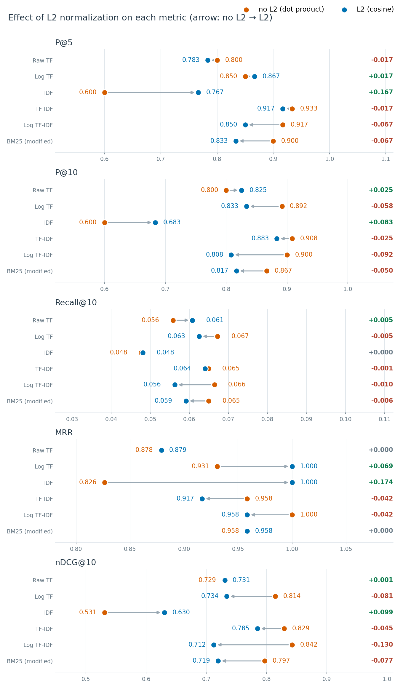
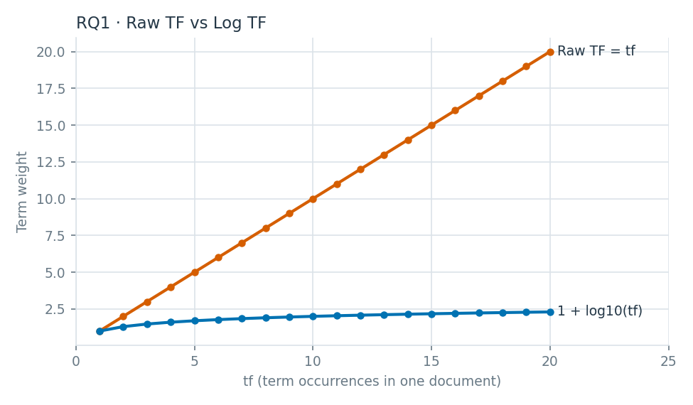
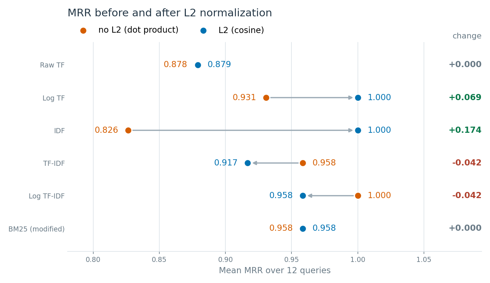

# Project #3 報告：Term Weighting 與向量空間檢索

> 課程：生醫資訊擷取技術（Biomedical Information Retrieval）　繳交期限：2026-10-27
> 系統：BioMed IR（Django + Docker），Project 3 頁面 `/analysis/term-weighting/`
> 本報告所有數字皆由 `python manage.py run_weighting_experiments` 產生，原始檔在 `docs/project3_results/`。

---

## 1. 系統說明

### 1.1 資料集

| 項目 | 內容 |
|---|---|
| 來源 | PubMed（NCBI E-utilities），查詢主題「GLP-1」，依相關度排序取前 3000 篇 |
| 文件數 N | **3000 篇**（每篇都有 PMID、英文摘要與 MeSH 標註） |
| 檢索欄位 | Abstract（含作者 Keywords 內容；去除 "Keywords:" 這個標籤字） |
| 相關性依據 | 每篇 PubMed XML 內的 MeSH headings（匯入時只收有 MeSH 的文章） |

### 1.2 系統架構

```
PubMed XML ─► search/indexer.py（HW1 解析）─► 資料庫 Document（title、abstract、PMID）
                                                   │
                       weighting/preprocessing.py  ▼   任務一：tokenize → lowercase → 去標點 → (stopword) → (stemming)
                       weighting/index.py          ▼   tf 稀疏矩陣（3000 × 25,865）＋ MeSH，存成 .npz / .json 快取
                       weighting/schemes.py        ▼   任務二：6 種權重 × 有無 L2，numpy / scipy.sparse 計算
查詢 ─► 同一前處理 ─► 同一詞彙空間的查詢向量 ─► 與所有文件計分 ─► 排序 ─► Top 10       （任務三）
                       weighting/experiments.py        任務四：對照實驗表格與圖
                       weighting/evaluation.py         任務五：MeSH 相關性 ＋ P@k、Recall@k、MRR、nDCG
```

- **快取**：第一次使用時把摘要前處理成 tf 矩陣，存到 `data/retrieval_cache/weighting/`；資料庫文件改變時簽章（文件數＋最後更新時間）不同，會自動重建。各方法的權重矩陣在記憶體中只算一次。
- **權重計算**：完全用 numpy / scipy.sparse 自行實作，沒有使用 sklearn 的 `TfidfVectorizer`；sklearn 只在單元測試裡用來驗證 Raw TF + L2 的結果一致。
- **網頁**：一頁分五段，依序為詞項統計、權重方法、搜尋 Top 10、比較模式、評估。搜尋可用下拉選單切換權重方法與 L2 開關。對照實驗（任務四）的表格由實驗指令輸出成 CSV／PNG，並整理在本報告第 5 節。

### 1.3 前處理（任務一）

| 步驟 | 作法 | 可開關 |
|---|---|---|
| Tokenization | 沿用 HW1 生醫 tokenizer：GLP-1、COVID-19、0.05 這類詞保持完整 | — |
| Lowercase | casefold | — |
| 去標點 | 獨立的標點不會成為 token；三種連字號（‐ ‑ –）統一成 "-" | — |
| Stopword removal | HW1 的 72 個 stopword | ✓（實驗固定：**開**） |
| Stemming | NLTK Porter stemmer | ✓（實驗固定：**關**） |

實驗不開 stemming，是為了保留原始詞形，讓詞權重表比較好解讀。開啟 stemming 時，詞彙量從 25,865 降為 20,560。

**語料統計（實驗設定）**

| 指標 | 數值 |
|---|---|
| 文件數 N | 3000 |
| Token 總數 | 429,590 |
| 詞彙量（vocabulary size） | 25,865 |
| 只出現一次的詞（hapax） | 10,958（42.4%） |
| 平均文件長度 | 143.2 tokens（中位數 145，範圍 4–506；10%–90% 落在 82–198） |



**DF 最高的詞**：`glp-1` 出現在 2955 / 3000 篇（98.5%），IDF 只有 0.0066。

數字「2」（DF 1407）與「1」（DF 1043）也進入前 15 名，因為 tokenizer 保留數字，而這兩個數字在 GLP-1 文獻中有特定來源：
- 「2」約 78%（1095 篇）來自「type 2」（第二型糖尿病）。
- 「1」約 55%（572 篇）來自「glucagon-like peptide 1」這種中間有空格的全名寫法；「type 1」只有 67 篇。

這也解釋了 `glucagon-like`（DF 2355）與 `peptide-1`（DF 1844）DF 不同：同一概念因連字號／空格寫法不同，被拆成不同詞，是 tokenization 的限制。

---

## 2. 方法與公式（任務二）

記號：N 為文件總數，tf(t,d) 為詞 t 在文件 d 的出現次數，df(t) 為含有 t 的文件數。

| 代號 | 方法 | 文件權重 w(t,d) | 查詢權重 |
|---|---|---|---|
| raw_tf | Raw TF | tf(t,d) | 查詢 tf |
| log_tf | Log TF | 1 + log10(tf)；tf = 0 時為 0 | 1 + log10(查詢 tf) |
| idf | IDF only | log10(N / df)，只要 tf > 0 | 同左 |
| tfidf | Raw TF × IDF | tf × log10(N / df) | 同左 |
| logtfidf | Log TF × IDF | (1 + log10 tf) × log10(N / df) | 同左 |
| bm25 | **額外比較**：BM25 (modified TF-IDF) | idf_BM25 × tf·(k1+1) / (tf + k1·(1 − b + b·\|d\|/avgdl))，k1 = 1.2、b = 0.75，idf_BM25 = log10(1 + (N − df + 0.5)/(df + 0.5)) | 查詢 tf |

**L2 normalization**（每種方法都有開／關兩種）：
- **有 L2**：文件與查詢向量都除以 ‖v‖₂ = √(Σ w²)，分數 = q̂ · d̂ = cos(q, d)，即任務三的 cosine similarity。
- **無 L2**：分數 = 原始內積 q · d。查詢向量長度對同一查詢是常數，不影響排名，所以差別在「文件向量有沒有正規化」，對應 RQ4。

共 6 種方法 × 2 種正規化 = **12 個實驗組合**（作業必要的是前 5 種 × 2 = 10 個）。

**單元測試**（`weighting/tests.py`，22 個全部通過）用 4 篇小語料手算驗證：

```
d1 = [glp1, obesity, obesity]          d2 = [glp1, insulin]
d3 = [insulin ×3, obesity]             d4 = [glp1 ×2, semaglutide]
df = [3, 2, 2, 1]   idf = log10(4/df) = [0.124939, 0.301030, 0.301030, 0.602060]
Log TF：d3 insulin = 1 + log10 3 = 1.477121
TF-IDF：d1 = [0.124939, 0.602060, 0, 0]
L2：d1 raw tf [1, 2] / √5 = [0.447214, 0.894427]
cosine("obesity insulin", d3) = 4 / (√2 · √10) = 0.894427
```

另含 P@k、Recall@k、MRR、nDCG 的手算值，矩陣版 cosine 與逐一公式計算一致，以及 Raw TF + L2 與 sklearn `TfidfTransformer(use_idf=False, norm='l2')` 一致。

---

## 3. 實驗設計（任務四、任務五）

### 3.1 控制變因

| 固定 | 改變 |
|---|---|
| 資料集：同一批 3000 篇摘要 | Weighting：raw_tf、log_tf、idf、tfidf、logtfidf（＋ bm25） |
| 前處理：移除 stopword、不 stemming | Normalization：無 L2 / 有 L2 |
| 查詢集：`weighting/queries.py` 的 12 個查詢 | |
| 詞彙表、IDF、排名規則（同分時以文件順序決定） | |

### 3.2 查詢集與相關性判斷

資料集沒有現成的 relevance labels，依作業說明改用**文件主題標籤（MeSH）**建立相關性集合：

- 每個查詢指定幾個 MeSH Descriptor（Q05 改用 Qualifier「adverse effects」）。
- 文件的 MeSH 含指定 descriptor 且為 **Major Topic** → relevance = 2；含但非 Major Topic → 1；都沒有 → 0。

| ID | 查詢 | MeSH 規則 | 相關篇數 | 其中 2 分 |
|---|---|---|---|---|
| Q01 | GLP-1 receptor agonists for obesity and weight loss | Obesity, Obesity Morbid, Weight Loss, Anti-Obesity Agents | 648 | 400 |
| Q02 | semaglutide | Semaglutide | 143 | 0 |
| Q03 | liraglutide treatment | Liraglutide | 266 | 56 |
| Q04 | cardiovascular outcomes and heart failure | Cardiovascular Diseases, Heart Failure, Cardiovascular System, Myocardium | 148 | 120 |
| Q05 | side effects and safety of GLP-1 drugs | [qualifier] adverse effects | 293 | 208 |
| Q06 | insulin secretion from pancreatic beta cells | Insulin-Secreting Cells, Insulin Secretion, Islets of Langerhans | 336 | 164 |
| Q07 | appetite and food intake regulation | Appetite, Appetite Regulation, Eating, Satiation, Satiety Response, Feeding Behavior | 283 | 140 |
| Q08 | DPP-4 inhibitors | Dipeptidyl-Peptidase IV Inhibitors, Dipeptidyl Peptidase 4 | 213 | 118 |
| Q09 | bariatric surgery gastric bypass | Bariatric Surgery, Gastric Bypass, Gastrectomy | 117 | 94 |
| Q10 | neuroprotection in Alzheimer and Parkinson disease | Alzheimer Disease, Parkinson Disease, Neurodegenerative Diseases, Neuroprotective Agents | 97 | 89 |
| Q11 | nonalcoholic fatty liver disease | Non-alcoholic Fatty Liver Disease, Fatty Liver | 47 | 39 |
| Q12 | gut microbiota | Gastrointestinal Microbiome | 77 | 54 |

### 3.3 評估指標

- **Precision@k** = 前 k 名中相關文件數 / k（k = 5、10）
- **Recall@10** = 前 10 名中相關文件數 / 語料中所有相關文件數
- **MRR** = 對所有查詢取平均的 1 / 第一篇相關文件名次（在完整排名上計算）
- **nDCG@10** = DCG@10 / IDCG@10，DCG = Σ (2^rel − 1) / log2(rank + 1)，使用 0 / 1 / 2 分級相關性

---

## 4. 結果

### 4.1 平均指標（12 個查詢）

| 組合 | P@5 | P@10 | Recall@10 | MRR | nDCG@10 |
|---|---|---|---|---|---|
| Raw TF（無 L2） | 0.800 | 0.800 | 0.056 | 0.878 | 0.729 |
| Raw TF + L2 | 0.783 | 0.825 | 0.061 | 0.879 | 0.731 |
| Log TF（無 L2） | 0.850 | 0.892 | **0.067** | 0.931 | 0.814 |
| Log TF + L2 | 0.867 | 0.833 | 0.063 | **1.000** | 0.734 |
| IDF（無 L2） | 0.600 | 0.600 | 0.048 | 0.826 | 0.531 |
| IDF + L2 | 0.767 | 0.683 | 0.048 | **1.000** | 0.630 |
| **TF-IDF（無 L2）** | **0.933** | **0.908** | 0.065 | 0.958 | 0.829 |
| TF-IDF + L2 | 0.917 | 0.883 | 0.064 | 0.917 | 0.785 |
| **Log TF-IDF（無 L2）** | 0.917 | 0.900 | 0.066 | **1.000** | **0.842** |
| Log TF-IDF + L2 | 0.850 | 0.808 | 0.056 | 0.958 | 0.712 |
| BM25（無 L2，額外） | 0.900 | 0.867 | 0.065 | 0.958 | 0.797 |
| BM25 + L2（額外） | 0.833 | 0.817 | 0.059 | 0.958 | 0.719 |





閱讀提醒：每個查詢的相關文件都在 47–648 篇之間，前 10 名最多只能找到 10 篇，所以即使完美排序，Recall@10 平均上限也只有 **0.072**，各方法差異很小，不適合拿來區分方法。12 個查詢是小樣本，本報告未做統計顯著性檢定，下列比較是「在這組資料上的觀察」。

### 4.2 逐查詢 nDCG@10（無 L2；有 L2 的版本見 `per_query_metrics.csv`）

| 查詢 | Raw TF | Log TF | IDF | TF-IDF | Log TF-IDF | BM25 |
|---|---|---|---|---|---|---|
| Q01 obesity / weight loss | 0.783 | 0.878 | 0.741 | 0.905 | **0.911** | 0.811 |
| Q02 semaglutide | **1.000** | **1.000** | 0.253 | **1.000** | **1.000** | **1.000** |
| Q03 liraglutide | **0.649** | 0.574 | 0.190 | 0.642 | 0.602 | 0.470 |
| Q04 cardiovascular | 0.780 | 0.890 | 0.821 | 0.890 | 0.855 | **0.931** |
| Q05 side effects | 0.000 | 0.221 | 0.148 | **0.471** | 0.405 | 0.244 |
| Q06 insulin secretion | 0.740 | 0.683 | 0.510 | **0.834** | 0.797 | 0.684 |
| Q07 appetite | 0.723 | 0.809 | 0.510 | 0.764 | **0.881** | 0.848 |
| Q08 DPP-4 | 0.956 | 0.956 | 0.143 | **1.000** | 0.956 | 0.956 |
| Q09 bariatric | 0.951 | 0.943 | 0.871 | 0.951 | 0.943 | **0.958** |
| Q10 neuroprotection | 0.529 | **0.820** | 0.805 | 0.631 | **0.820** | 0.754 |
| Q11 NAFLD | 0.727 | **1.000** | 0.915 | 0.934 | **1.000** | **1.000** |
| Q12 gut microbiota | 0.915 | **1.000** | 0.466 | 0.931 | 0.936 | 0.905 |

IDF only 在 Q02（semaglutide）、Q08（DPP-4）只有 0.253、0.143：單一詞的查詢下，所有含該詞的文件 IDF 分數都一樣，排名只能靠同分時的文件順序，等於沒有排序能力。

---

## 5. 研究問題

### RQ1：Raw TF 與 Log TF 的差異，如何影響文件的詞項權重？

| tf | Raw TF | Log TF = 1 + log10(tf) |
|---|---|---|
| 1 | 1 | 1.000 |
| 2 | 2 | 1.301 |
| 10 | 10 | 2.000 |
| 20 | 20 | 2.301 |



實際文件中（`rq1_rq2_term_weights.csv`）：

| 詞 | PMID | tf | Raw TF | Log TF | TF-IDF | Log TF-IDF |
|---|---|---|---|---|---|---|
| insulin | 24589127 | 22 | 22 | 2.342 | 8.899 | 0.948 |
| insulin | 39114288 | 1 | 1 | 1.000 | 0.405 | 0.405 |
| glp-1 | 24267262 | 34 | 34 | 2.531 | 0.223 | 0.017 |
| semaglutide | 38470137 | 10 | 10 | 2.000 | 10.844 | 2.169 |

**回答**：Raw TF 讓權重與次數成正比，insulin 出現 22 次的權重是出現 1 次的 22 倍；Log TF 把差距壓成 2.34 倍，tf 每增加 10 倍只多 1。對排名的影響：

- 無 L2 時，Log TF 的 nDCG@10 是 0.814，Raw TF 是 0.729；P@10 分別為 0.892 與 0.800。
- Raw TF 容易被「重複最多次的詞」主導：查詢「GLP-1 obesity weight loss」用 Raw TF（無 L2）時，第 1 名是 PMID 24267262，一篇談 GLP-1 與動脈粥狀硬化的論文，因為它把 glp-1 重複了 34 次；Q05「side effects and safety of GLP-1 drugs」用 Raw TF 不論有無 L2，前 10 名都是 glp-1 出現 10–34 次、卻幾乎沒有 safety／side 的文件，10 篇全不相關（nDCG = 0）。
- 但 Raw TF 不是每題都差：Q03 liraglutide 反而是 Raw TF 最高（0.649），因為主題詞本身在相關文件中會反覆出現。

### RQ2：為什麼 IDF 能降低常見詞的重要性，並提高較具辨識力詞項的權重？

| 高 DF 詞 | DF | IDF | | 低 DF 詞 | DF | IDF |
|---|---|---|---|---|---|---|
| glp-1 | 2955 | 0.007 | | gzr18 | 3 | 3.000 |
| glucagon-like | 2355 | 0.105 | | visfatin | 3 | 3.000 |
| peptide-1 | 1844 | 0.211 | | pbh | 4 | 2.875 |
| diabetes | 1534 | 0.291 | | gdf15 | 5 | 2.778 |
| receptor | 1484 | 0.306 | | mafld | 5 | 2.778 |
| effects | 1390 | 0.334 | | l-arginine | 5 | 2.778 |
| glucose | 1222 | 0.390 | | lsg | 5 | 2.778 |
| insulin | 1182 | 0.405 | | xglp | 5 | 2.778 |

**回答**：IDF = log10(N / df)。一個詞出現的文件越多，N / df 越接近 1，IDF 越接近 0。這批文件本來就是用 GLP-1 搜尋出來的，`glp-1` 出現在 98.5% 的文件，IDF 只有 0.007，幾乎無法區分文件；只出現在 3–5 篇的詞 IDF 為 2.8–3.0，約是 glp-1 的 400 倍。

同一篇文件內也看得到：`glp-1` 出現 34 次，TF-IDF 只有 0.223；`semaglutide` 出現 10 次，TF-IDF 是 10.844，高出約 49 倍。IDF 把權重從「整個語料都在講的詞」移到「只有少數文件在講的詞」，後者通常才是區分主題的關鍵詞。需要注意的是，低 DF 詞也包含縮寫或藥物代號（如 `gzr18`、`xglp`），IDF 高不一定代表有意義。

### RQ3：相較於只用 TF 或只用 IDF，TF-IDF 是否能產生較好的搜尋排名？

| 比較（nDCG@10 平均） | 無 L2 | 勝 / 負 / 平 | 有 L2 | 勝 / 負 / 平 |
|---|---|---|---|---|
| TF-IDF vs Raw TF | 0.829 vs 0.729 | 9 / 1 / 2 | 0.785 vs 0.731 | 6 / 4 / 2 |
| TF-IDF vs IDF only | 0.829 vs 0.531 | 11 / 1 / 0 | 0.785 vs 0.630 | 10 / 2 / 0 |
| Log TF-IDF vs Log TF | 0.842 vs 0.814 | 5 / 2 / 5 | 0.712 vs 0.734 | 5 / 6 / 1 |
| Log TF-IDF vs IDF only | 0.842 vs 0.531 | 12 / 0 / 0 | 0.712 vs 0.630 | 9 / 2 / 1 |

**回答**：在 3000 篇的語料上，**大致是**。
- **相對於只用 IDF**：結果一致，TF-IDF 與 Log TF-IDF 在 12 個查詢中有 9–12 個勝過 IDF only。IDF only 只看「有沒有出現」，一篇只順帶提到一次的摘要，和整篇都在討論的摘要同分。
- **相對於只用 TF**：無 L2 時一致較好（TF-IDF 9 勝 1 負；Log TF-IDF 5 勝 2 負、5 平）。有 L2 時，Raw TF → TF-IDF 仍提高，但 Log TF-IDF（0.712）略低於 Log TF（0.734）。
- 整體最佳是 **Log TF-IDF（無 L2，nDCG@10 0.842）** 與 **TF-IDF（無 L2，P@5 0.933、P@10 0.908）**，也就是同時考慮「出現頻率」與「區分力」的組合。

### RQ4：文件向量是否需要 L2 normalization？正規化前後的排名有何差異？

**示範**（查詢「GLP-1 obesity weight loss」，`rq4_length_demo.csv`）：

| 方法 | Top 10 平均長度：無 L2 → 有 L2 | 兩邊 Top 10 重疊 |
|---|---|---|
| TF-IDF | 203.3 → 110.9 tokens | 2 / 10 |
| Log TF-IDF | 197.7 → 85.4 tokens | 0 / 10 |

（全語料平均 143.2 tokens）Log TF-IDF + L2 的前 6 名長度只有 50–86 tokens，第 1 名是 50 tokens 的短摘要（PMID 37460364）。

**全部 12 個查詢**（`rq4_top10_length_by_method.csv`）：

| 方法 | Top 10 平均長度（無 L2 → 有 L2） | Top 10 重疊 | nDCG@10（無 L2 → 有 L2） | L2 後變好 / 變差的查詢數 |
|---|---|---|---|---|
| Raw TF | 180.6 → 137.2 | 5.5 / 10 | 0.729 → 0.731 | 6 / 3 |
| Log TF | 171.8 → 97.7 | 3.6 / 10 | 0.814 → 0.734 | 3 / 9 |
| IDF | 139.1 → 89.5 | 3.3 / 10 | 0.531 → 0.630 | 8 / 4 |
| TF-IDF | 176.1 → 127.2 | 5.2 / 10 | 0.829 → 0.785 | 4 / 6 |
| Log TF-IDF | 171.6 → 98.3 | 3.0 / 10 | 0.842 → 0.712 | 2 / 10 |
| BM25 | 143.3 → 105.8 | 5.3 / 10 | 0.797 → 0.719 | 3 / 9 |



**回答**：
- **排名明顯不同**：不做 L2 時分數是內積，長文件詞多、權重總和大，Top 10 平均長度 139–181 tokens（高於語料平均 143）；做 L2 後降到 89–137，平均只有 3–5.5 篇相同，L2 會換掉一半以上的 Top 10。
- **對檢索效果**：本資料集中，L2 只讓 Raw TF（+0.002）與 IDF（+0.099）的 nDCG@10 提升；Log TF、TF-IDF、Log TF-IDF、BM25 都下降，Log TF-IDF 降最多（−0.130）。
- **可能原因**：3000 篇的長度範圍很大（4–506 tokens，有 140 篇少於 60 tokens）。相關與不相關文件的平均長度其實差不多（147 vs 143 tokens），所以不是「相關文件比較長」。比較可能的原因是：L2 後排名主要看查詢詞在文件中的「密度」，短摘要只要剛好提到查詢詞就會排很前面；無 L2 時，文件必須多次提到查詢詞（較可能是在討論該主題）才能排前面。Log TF 與 BM25 本身已壓縮重複次數或做長度正規化，再加 L2 就變成過度偏好短文件。這個解釋未逐篇驗證。
- **結論**：要做 cosine similarity，L2 是必要步驟，而且會大幅改變排名；但 L2 會不會「提升」評估指標，取決於權重方法本身是否已有長度控制，以及語料的長度分布。

### RQ5：不同 weighting 方法對 Precision@k、MRR 或 nDCG 等指標有何影響？

1. **Precision@5／@10**：TF-IDF（無 L2）最高（0.933／0.908），Log TF-IDF（無 L2）次之（0.917／0.900）；IDF only（無 L2）最低（0.600）。
2. **MRR**：多數組合 ≥ 0.92；Log TF + L2、IDF + L2、Log TF-IDF（無 L2）達 1.000（每個查詢第 1 名都相關）。Raw TF 最低（0.878），因為大量重複 glp-1 的文件容易排第 1。MRR 只看第一篇相關文件，對前 10 名後段不敏感。例如 IDF + L2 的 MRR 是 1.000，nDCG 卻只有 0.630。
3. **nDCG@10**：最能區分方法。Log TF-IDF（無 L2）0.842、TF-IDF（無 L2）0.829、Log TF（無 L2）0.814 為前三；IDF only 最低（0.531）。
4. **Recall@10**：上限只有 0.072，各方法都在 0.048–0.067，不適合用來區分方法。
5. **不同指標的最佳方法不同**：P@k 最好是 TF-IDF，nDCG 最好是 Log TF-IDF，MRR 有三個組合並列第一；逐查詢來看，12 個查詢的最佳方法也分散在六種方法之間。

---

## 6. 補充觀察：同一套方法，1000 篇與 3000 篇的結論不同

本專案最初用 1000 篇 GLP-1 摘要做過同樣的實驗，結論和 3000 篇不一樣：

| | 1000 篇 | 3000 篇 |
|---|---|---|
| nDCG@10 最佳 | TF-IDF + L2（0.718） | Log TF-IDF 無 L2（0.842） |
| L2 對 TF-IDF 的影響 | 提升（0.705 → 0.718） | 下降（0.829 → 0.785） |
| L2 對 Raw TF、IDF 的影響 | 提升 | 提升 |
| IDF only | 最差 | 最差 |

不變的是「IDF only 最差」、「Log TF 優於 Raw TF（無 L2）」、「L2 會大幅改變排名」；改變的是「L2 是否提高指標」與「哪個組合最好」。語料變大後，文件長度範圍變寬、相關文件變多，L2 偏好短文件的效果被放大。這說明 weighting 方法的優劣必須結合資料集判斷。

---

## 7. 限制

1. **相關性來自 MeSH，不是人工判讀**：MeSH 標註可能不完整；有些概念在 MeSH 中沒有對應 descriptor（如 nausea、pancreatitis 幾乎沒被標註，所以 Q05 改用 qualifier「adverse effects」）；Q02 的 Semaglutide 在 143 篇中沒有一篇是 Major Topic，所以 Q02 只有 1 分的相關性。
2. **規則與查詢詞重疊造成偏差**：Q02 semaglutide、Q03 liraglutide 這類查詢詞與 MeSH 名稱相同，對完全比對的方法較有利。
3. **語料主題同質**：3000 篇都是 GLP-1 搜尋結果，`glp-1` 的 IDF 幾乎為 0。在主題較分散的語料上，IDF 與 TF-IDF 的效果可能不同。
4. **樣本數**：12 個查詢是小樣本，沒有做統計顯著性檢定。
5. **只用摘要**：沒有使用全文與標題，短摘要的資訊量有限。
6. **只取搜尋結果前 3000 篇**：依 PubMed 相關度排序取前 3000 篇，並非 GLP-1 全部文獻的隨機樣本。

---

## 8. 結論

- **詞頻與重要性不是等比例**：Log TF 把 tf = 22 的權重從 22 倍壓到 2.34 倍；無 L2 時 Log TF 的 nDCG@10（0.814）高於 Raw TF（0.729）。Raw TF 會被重複 34 次的 glp-1 帶偏。
- **常見詞缺乏區分力**：glp-1 出現在 98.5% 的文件，IDF = 0.007；只用 IDF 是所有組合中最差的，而加入 IDF 的 TF-IDF 在 12 個查詢中有 11–12 個勝過 IDF only。
- **正規化會改變排名**：有無 L2 的 Top 10 平均只重疊 3–5.5 篇；L2 讓 Top 10 從偏長文件（139–181 tokens）變成偏短文件（89–137 tokens）。在本資料集中，L2 只對 Raw TF 和 IDF 有幫助。
- **沒有永遠最好的方法**：Log TF-IDF（無 L2）的 nDCG@10 最高，TF-IDF（無 L2）的 P@k 最高，MRR 有三個組合並列；同一套方法從 1000 篇換到 3000 篇，最佳組合也改變了。選擇 weighting 方法必須同時考慮查詢、資料集與評估指標。

## 附錄：重現方式

```powershell
docker compose up --build -d
docker compose exec web python manage.py run_weighting_experiments   # 產生 docs/project3_results/*
docker compose exec web python manage.py test weighting              # 22 個單元測試
```

| 輸出檔 | 內容 |
|---|---|
| corpus_summary.csv、top_df_terms.csv、doc_length_distribution.csv/.png | 任務一 詞項統計 |
| rq1_tf_scaling.csv、rq1_tf_vs_logtf.png、rq1_rq2_term_weights.csv | RQ1、RQ2 詞權重示範 |
| rq2_idf_high_vs_low_df.csv | RQ2 高 / 低 DF 詞 IDF |
| rq4_length_demo.csv、rq4_top10_length_by_method.csv | RQ4 長短文件與 L2 |
| relevance_sets.csv | 每個查詢的 MeSH 規則與相關篇數 |
| per_query_metrics.csv、mean_metrics.csv | 任務五 評估結果 |
| metrics_comparison.png、l2_effect_mrr.png、l2_effect_all_metrics.png | 指標熱圖、L2 前後比較圖 |
| top10_rankings.csv | 每個查詢 × 每個組合的 Top 10（附相關等級） |
| summary.json | 以上重點數字彙整 |
